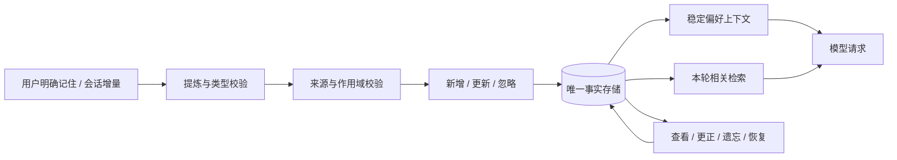

# 参考仓库记忆功能调研

调研日期：2026-10-29（Asia/Hong_Kong）。范围：`reference-repos/` 下全部 13 个独立 Git 仓库，并与当前 miniQ 实现对照；其中 AgentMemory 是后续按用户要求新增克隆的项目。

结论：miniQ 最值得优先借鉴的是 **MicroClaw 的分层注入、Moltis 的文件与索引分工、LibreFang 的新增/更新/忽略决策、Codex 的后台提炼与来源追踪，以及 AgentMemory 的跨工具事件采集和旧版本退出召回机制**。向量检索只是其中一个组件；真正决定体验的是何时保存、如何修正、如何召回，以及删除后会不会再次出现。

## 1. 更新记录与调研边界

原有 12 个仓库已与本次拉取的各自 upstream 对齐，最终工作区均干净：9 个有更新，3 个原本就是最新。另完整克隆 AgentMemory 的默认分支，含 Git 历史，克隆后也与 upstream 对齐且工作区干净。下列提交号标识各次拉取的调研快照，不表示其他仓库在后续补充调研时又进行了一次拉取。

| 仓库 | 分支 | 更新前 | 更新后 | 新提交数 |
| --- | --- | --- | --- | ---: |
| codex | main | `342ed69` | `23934d31b15b1127c83535f84854e5009f7cd51d` | 347 |
| deepseek-harness | master | `cd5ef81481` | `f3803c96974ad4a94195fb97e5c637e9c2a3afe3` | 10345 |
| harness2 | main | `1cfe254` | `1cfe254e8d25b15f37048c3730134686abe60335` | 0 |
| ironclaw | main | `2b2e63f98` | `b0b999d96781516ee05e6ba961d6f3ead900da96` | 954 |
| librefang | main | `b01e37af` | `7b43a3fc82277a15775ce1663a1b5d85dcc37aea` | 1715 |
| microclaw | main | `ce1e353` | `3c1b14eb28303e4eb7fcf095e51f3de5a23f5245` | 216 |
| moltis | main | `48c9a419` | `8a12400dc10551dfb9a6b568414b91a343ef2d5d` | 255 |
| opencrust | main | `f564e0c` | `f564e0c05014bd535e73ed1f6d811ad46f9cb5a1` | 0 |
| openfang | main | `acf2587` | `acf2587e46be174c10200489c9a2d23a39a98aeb` | 0 |
| tutti | main | `87c36fb` | `207beeea554435618dffd3b579d0ffe112b065c4` | 5356 |
| UI-TARS-desktop | main | `c2ad42e3` | `3ac2cb8d946d78d5ff92ad17b318eaafa18c178c` | 8 |
| zeroclaw | master | `e72f88742` | `99bd353c756f4e64f381cfe9c3002ebff32f3055` | 1555 |
| agentmemory | main | 未克隆 | `b2629cb1e7091c0dece7d34b9f97b6b76be83418` | 新增完整克隆 |

更新前，12 个参考仓库的工作区均干净。采用快进更新；网络失败时使用机器已有代理、HTTP/1.1 和仅获取当前分支的方式重试。未创建提交、合并提交或发布版本，未更新 miniQ 主仓库分支。

新增仓库为 [rohitg00/agentmemory](https://github.com/rohitg00/agentmemory)，本地目录 `reference-repos/agentmemory`，源码版本 `0.9.31`，Apache-2.0 许可证。仅克隆和阅读源码，未运行安装向导、接入个人 Agent 或启动记忆服务。

本报告依据更新后的源码、默认配置和调用入口，属于静态实现调研，未运行这些第三方项目的应用、模型调用或测试套件。文档中的计划不等同于已经接入的功能。对“未发现独立长期记忆”的判断，限定于所检查的运行时代码、工具和文档，并非对外部 SDK 能力的断言。

IronClaw 按仓库指引使用架构说明与源码检索，重点核对当前 Reborn 的 provider、运行时装配及生命周期入口，避免把旧路径或草案直接当成现状。

## 2. 先区分三种“记忆”

| 类型 | 解决的问题 | 是否自然具有跨会话知识能力 |
| --- | --- | --- |
| 会话持久化 | 重启后恢复原聊天、消息和工具结果 | 需要额外召回机制 |
| 上下文压缩 | 当前聊天过长，压成摘要继续执行 | 主要服务于当前会话 |
| 长期记忆 | 以后聊天仍能使用偏好、事实、决策和经验 | 需要写入、检索、更新、遗忘的完整流程 |

把对话存进 SQLite、把旧聊天压成摘要，或者出现一个名为 `MemoryStorageProvider` 的内存存储类，都不足以证明项目实现了长期记忆。

## 3. 全部仓库对照

| 仓库 | 写入机制 | 读取/注入机制 | 主要特点与边界 |
| --- | --- | --- | --- |
| Codex | 后台从会话提炼，再集中整理 Markdown 产物 | 注入短摘要，按需检索和读取详细来源 | 两阶段处理、任务租约、来源引用、使用次数及未使用时间；V1/V2 并存且配置默认 V1 |
| MicroClaw | 明确“记住”指令、记忆工具、定时 reflector | 身份/重要事实/当前相关事实分层注入，工具进一步检索 | 置信度、替代关系、去重、时效衰减、注入日志；稳定与动态上下文分开 |
| Moltis | 记忆工具、周期提炼、压缩前保存、结束时摘要 | 核心文件进入提示词；关键词+向量检索；每轮预取 | Markdown 是可读源，SQLite 是索引；来源行号、删除同步和 checkpoint |
| LibreFang | 轮次结束后提炼，执行 ADD/UPDATE/NOOP | 轮次开始前自动召回，支持关键词和向量 | mem0 风格自实现；User/Session/Agent 分层、来源作用域、版本与衰减 |
| ZeroClaw | 显式工具与轮次提炼，形成 Daily/Core | SQLite FTS5+向量混合召回，经统一注入入口 | 去重、重要性、替代、预算、作用域；可选 MMR 重排，读缓存默认关闭 |
| IronClaw | 长期事实写入文档；轮末另存完整交互；可选周期整理 | 长期文档前缀+全文命中，与当前线程短期召回分开 | native 默认全文检索，后台整理需显式配置；可替换为能力不同的 mem0 provider |
| OpenFang | 自动保存每轮交互；另有键值记忆工具 | 每轮自动召回相关交互，优先向量，否则 LIKE | structured/semantic/knowledge graph 三类存储；现有 consolidation 主要降低旧记忆置信度 |
| OpenCrust | 自动保存用户/助手消息；显式保存持久笔记 | continuity_key 连接会话，关键词/向量/时间综合排序 | 实现直观；会话历史、显式笔记和文档 RAG 要分别看待 |
| DeepSeek Harness | 通过可选的第三方记忆 MCP 工具写入 | 通用 MCP 工具发现，由模型调用服务检索 | 不自建同类记忆引擎；示例默认关闭，存储与治理由提供方负责 |
| harness2 | 把可复用领域事实维护在 harness 文件中 | `LongTermMEMORY.md` 等内容常驻提示词 | 属于 harness 优化的知识组件；未发现运行时用户画像提炼与检索管线 |
| Tutti | 主要持久化会话及 provider 状态 | 恢复会话，并适配 Claude SDK 等运行时的压缩事件 | 本次未发现独立的长期事实记忆引擎 |
| UI-TARS-desktop | 主要存储会话事件和执行轨迹 | 事件流重新组装模型历史，限制历史图片数量 | 本次未发现独立的用户长期记忆提炼/召回引擎 |
| AgentMemory | hooks/插件采集、显式保存、会话摘要及可配置归纳 | BM25 基线，可叠加向量/图谱并用 RRF 融合，MCP/REST 访问 | 跨 Agent 服务、版本替代、来源、离线重试；LLM 逐条压缩与共享 hook 注入默认关闭；评测须区分检索与回答质量 |

## 4. 重点实现

### 4.1 Codex：后台提炼 + 全局整理 + 渐进读取

根会话启动时，在非临时会话、功能启用和数据库可用等条件下，异步启动记忆任务。子 Agent 不重复触发这套启动流程。

第一阶段挑选符合空闲时间、年龄窗口和处理状态的会话，领取数据库任务租约，再调用模型提炼。生成内容做密钥脱敏，结果记录到数据库。并发数和每次处理量受限，失败任务有退避。

第二阶段取得全局处理租约和工作区锁，按照使用情况与时间选择输入，生成会话摘要文件，并用工作区 diff 驱动整理 Agent。来源删除也进入 diff，使整理过程能够移除失去依据的结论。

当前源码存在两个版本，不能只看旧 README：

- **V1，配置默认值**：提炼 `raw_memory` 和 `rollout_summary`；整理 `raw_memories.md`、`rollout_summaries/`，再维护 `MEMORY.md`、`memory_summary.md` 等产物。
- **V2，可配置选择**：第一阶段只输出 `rollout_summary` 和 slug；第二阶段主要维护短小的 `memory_summary.md`，其中保留用户偏好及按项目组织的来源入口，减少多份派生长文。

读取端把短摘要放入上下文，详细证据按需读取。当前本地搜索实现是文件文本匹配，支持多个查询、行窗口及游标分页，并非依赖向量库。引用和读取使用情况另有记录模块。

值得借鉴：后台任务幂等、明确来源、区分一次性任务要求与长期偏好，以及“短索引引导详细读取”。无需为借鉴这个流程先实现复杂向量基础设施。V2 对输出和旧实现对输入存在截断行为，miniQ 不应直接照搬，应保留完整原始来源并分批处理。

源码：[启动](../../reference-repos/codex/codex-rs/memories/write/src/start.rs)、[提炼](../../reference-repos/codex/codex-rs/memories/write/src/phase1.rs)、[整理](../../reference-repos/codex/codex-rs/memories/write/src/phase2.rs)、[版本化输出](../../reference-repos/codex/codex-rs/memories/write/src/phase1_output.rs)、[V2 整理提示词](../../reference-repos/codex/codex-rs/memories/write/templates/memories/consolidation_v2.md)、[本地搜索](../../reference-repos/codex/codex-rs/ext/memories/src/local/search.rs)、[默认配置](../../reference-repos/codex/codex-rs/config/src/types.rs)。

### 4.2 MicroClaw：分层记忆与生命周期

同时存在可读文件记忆与 SQLite 结构化记忆。结构化条目具有类别、置信度、来源、最近出现时间和归档状态，并记录记忆替代关系。

写入有三个入口：明确的“记住”指令可以走快速路径；模型可以调用工具；后台 reflector 默认每 15 分钟检查活跃会话，按游标读取新增对话并提炼。提炼结果经过质量检查、去重及替代处理，不是把每句话都当成事实追加。

读取分成：

| 层 | 内容 | 默认预算策略 |
| --- | --- | --- |
| L0 Identity | PROFILE 身份事实 | 约 20% |
| L1 Essential | 高置信度、仍有时效性的关键事实 | 约 30% |
| L2 Relevant | 与本轮问题匹配的记忆 | 剩余预算 |
| Connected | 从问题中的实体扩展的知识图谱信息 | 受配置和查询限制 |
| L3 工具检索 | 更深入的历史信息 | 模型按需调用 |

默认结构化记忆预算为 1500 tokens，但代码使用字符长度估算，并非精确 tokenizer 预算。非 PROFILE 记忆的排序权重随时间衰减，默认半衰期 30 天；PROFILE 不参与这项衰减。

本次更新后的实现还把 Identity/Essential 留在稳定提示词部分，把 Relevant/Connected 放入每轮变化的上下文，降低查询变化对提示词缓存的影响。

值得借鉴：分层加载、明确修正优先于旧事实、注入日志，以及稳定/动态上下文分离。图谱不是 miniQ 第一阶段的必要条件；其中依赖启发式主题键或长度裁剪的部分也不宜直接复制。

源码：[记忆服务](../../reference-repos/microclaw/crates/microclaw-engine/src/memory_service.rs)、[Agent 调用入口](../../reference-repos/microclaw/crates/microclaw-engine/src/agent_engine.rs)、[reflector](../../reference-repos/microclaw/src/scheduler.rs)、[默认配置](../../reference-repos/microclaw/crates/microclaw-engine/src/config/core.rs)、[质量检查](../../reference-repos/microclaw/crates/microclaw-engine/src/internal/storage/memory_quality.rs)。

### 4.3 Moltis：可读文件、自动提炼和可恢复删除

记忆主体位于 `MEMORY.md`、`memory/*.md` 等 Markdown 文件中。索引器进行分块、内容更新检测、embedding 和全文索引。文件可以独立阅读；SQLite 搜索索引可以从源文件重建。

当前默认配置已经包括每轮预取最多 3 条相关记忆，以及每 5 轮后台提炼一次。调用入口限制在适合使用私人记忆的上下文，并尊重写入开关。除此之外，压缩前会运行一次静默保存，结束会话时也可生成记忆摘要；会话导出又是独立功能。

内置检索结合 SQLite FTS5 和向量，提供 RRF 或线性融合；LLM 重排是可选项，默认关闭。QMD 是可选外部检索后端。搜索结果保留路径和行号，模型可继续读取完整片段。

`memory_save`、精确删除和自然语言遗忘围绕同一份文件源操作。工具写入/删除建立 checkpoint；删除源内容后同步索引。自然语言遗忘在匹配不唯一或数据已变化时返回预览，避免只删除索引、下次重建又恢复。

值得借鉴：把记忆保存、查询使用、自动提炼、用户画像写入设成清楚的策略；让用户能查看、更正和恢复记忆。如果 miniQ 继续以数据库为主，则 Markdown 应是导出或派生视图，避免再维护一套互相覆盖的事实源。

源码：[配置默认值](../../reference-repos/moltis/crates/config/src/schema/memory.rs)、[每轮预取](../../reference-repos/moltis/crates/chat/src/run_with_tools.rs)、[周期提炼](../../reference-repos/moltis/crates/chat/src/service/chat_impl/send.rs)、[压缩前保存](../../reference-repos/moltis/crates/chat/src/service/chat_impl.rs)、[静默轮次](../../reference-repos/moltis/crates/agents/src/silent_turn.rs)、[混合搜索](../../reference-repos/moltis/crates/memory/src/search.rs)、[记忆工具](../../reference-repos/moltis/crates/memory/src/tools.rs)、[管理器](../../reference-repos/moltis/crates/memory/src/manager.rs)。

### 4.4 LibreFang：mem0 风格的记忆决策

这是仓库内的实现，不应理解为“直接接入 mem0 才能工作”。成功轮次结束路径调用 `auto_memorize`；构造后续请求时调用 `auto_retrieve`，流式和非流式路径均有接线。

模型或规则提炼器产出记忆候选，经过类别与置信度筛选；默认提炼阈值为 0.7。随后查找已有相近条目，执行明确的三选一决策：

- ADD：新增独立事实。
- UPDATE：用新信息修改已有条目，保留相关版本/冲突信息。
- NOOP：已有记忆覆盖了这条内容，不重复写入。

作用域包含 User/Session/Agent，另外叠加 agent、peer、chat 和 session 等过滤条件。特别是公开 Agent 的不同访问者会话，不能仅因为条目标为 User 就跨会话泄漏。最新代码把 session 过滤与 chat 过滤同时应用到召回和去重候选。

维护策略包括重复合并、置信度衰减和按作用域 TTL 清理。TTL 清理对 Session/Agent 软删除，User 不受该 TTL 清理影响；软删除记录可在保留期后再物理删除。不能把“User 不受 TTL 清理”扩大解释为任何维护流程都不会修改它。

值得借鉴：把“保存记忆”建模成有结果的决策，而不是永远 INSERT；把来源和使用者作用域贯穿写入、去重和召回全过程。

源码：[数据类型与决策接口](../../reference-repos/librefang/crates/librefang-types/src/memory.rs)、[主动记忆](../../reference-repos/librefang/crates/librefang-memory/src/proactive.rs)、[轮次结束入口](../../reference-repos/librefang/crates/librefang-runtime/src/agent_loop/end_turn.rs)、[召回入口](../../reference-repos/librefang/crates/librefang-runtime/src/agent_loop/prompt.rs)、[合并](../../reference-repos/librefang/crates/librefang-memory/src/consolidation.rs)、[TTL 清理](../../reference-repos/librefang/crates/librefang-memory/src/decay.rs)。

### 4.5 ZeroClaw：统一召回入口与可配置治理

默认 SQLite 后端提供 FTS5/BM25、embedding 和向量相似度融合；另有 Markdown、Postgres、Qdrant 等后端实现。轮次提炼把事件摘要写到 Daily，将适合长期保存的事实写到 Core；显式记忆工具仍是另一个入口。

更新后的提炼路径会经过策略检查、重复判断和合并/替代处理。可选类型进一步区分偏好、事实、决策和实体。流程性知识在新提炼提示词中被引导到 skills，不是所有内容都堆入长期事实记忆。

当前 `memory_inject.rs` 统一决定何时召回、怎样过滤和如何渲染。默认路径考虑时间衰减；开启重排后，会对候选进行重要性/时间综合评分、去重和可选 MMR，以兼顾相关性和结果多样性。重排默认关闭，这里不是默认的额外 LLM 调用。

一个容易误读的点：`RetrievalPipeline` 目前只是可选热缓存装饰器，默认缓存关闭。其最新注释明确说明 FTS/vector 阶段名称还没有形成多个独立后端调用；真正的混合检索发生在后端，不能将它宣传成已经实现的三级独立检索。

值得借鉴：所有入口共享一次记忆注入策略，避免 CLI、网页、定时任务各自定义不同的过滤规则。原始自动保存消息和工具输出应有明确类别，避免再次作为高可信事实注入，形成重复放大。

源码：[SQLite 检索](../../reference-repos/zeroclaw/crates/zeroclaw-memory/src/sqlite.rs)、[提炼](../../reference-repos/zeroclaw/crates/zeroclaw-memory/src/consolidation.rs)、[统一注入](../../reference-repos/zeroclaw/crates/zeroclaw-runtime/src/agent/memory_inject.rs)、[重排](../../reference-repos/zeroclaw/crates/zeroclaw-memory/src/rerank.rs)、[缓存实际语义](../../reference-repos/zeroclaw/crates/zeroclaw-memory/src/retrieval.rs)、[Agent 隔离](../../reference-repos/zeroclaw/crates/zeroclaw-memory/src/agent_scoped.rs)。

### 4.6 IronClaw：长期文档、线程记录和可选整理

当前 Reborn 通过 `MemoryService` 契约连接具体 provider。默认 `memory-native` 位于 `crates/extensions/packages/memory-native`，以 `FilesystemMemoryDocumentRepository` 叠加 `RootFilesystem` 保存 `/memory` 虚拟文档。不能把旧 `src/workspace` 实现或历史数据库表直接当成当前架构。

写入分为两条不同路径：模型通过记忆工具把值得长期保留的偏好、事实或更正写入 `MEMORY.md`；完成轮次后，宿主另把该轮完整且有序的用户、助手和工具内容交给 `record_interaction`。native 将后者原样写成 `threads/<thread_id>/<turn_run_id>.md`，同一 run 重试覆盖同一路径，避免重复追加。**原始交互记录不等于自动提炼后的长期事实。**

读取也分两条：`read_long_term` 先提供与本轮查询无关的 `MEMORY.md` 前缀，再补充相关全文命中，并排除线程记录；`read_short_term` 只检索当前线程子树。host 最终优先接纳短期结果，再接纳长期结果，两者共享数量和字节预算，因此“长期文档进入 lane”不代表整份文档必然完整进入模型。结构化 timezone/locale/location 使用 `profile_set`，按 tenant/user 保存，不绑定具体 agent/project；一般文档则使用完整 tenant/user/agent/project 作用域。

native 的实际搜索和上下文召回显式 `.with_vector(false)`。全文查询经 `FtsRanked` 使用后端相关性排序（如 BM25/ts_rank），而非要求整句每个词都匹配。底层保留向量数据和 RRF 融合能力，但当前没有自动生成 embedding 的 provider 接口，不能声称默认已启用混合向量搜索。

最新实现提供后台整理：重新读取长期文档，合并重复内容、整理措辞，并仅在新旧关系明确时移除被替代事实。manifest 推荐每 10 个完成轮次执行一次，**实际需要显式配置 `memory.curation_interval_turns` 才启用，未设置时不运行**。它不是从所有历史聊天中挖掘新事实的提炼任务；提示词禁止添加原文没有的事实。替换写入要求传入读取时的内容哈希，发生并发冲突则停止，且仍经过正常权限机制。

可选的自托管 mem0 provider 需要编译特性和部署配置。它用语义搜索提供长期召回，但工具写入设为 `infer=false`，不让 mem0 改写文档内容；当前不声明短期召回、交互记录或周期整理。不能从“支持 mem0”推导出这些功能自动存在。

召回片段在 host 再检查作用域、脱敏并包成不可信内容。值得借鉴的是：将长期事实与原始交互分开，允许后台整理但明确成本开关，并用内容哈希保护用户并发更正。其上下文存在裁剪；miniQ 应保留完整来源，通过按需读取补足预算外内容。

源码：[native 服务](../../reference-repos/ironclaw/crates/extensions/packages/memory-native/src/service.rs)、[全文检索映射](../../reference-repos/ironclaw/crates/extensions/packages/memory-native/src/repo/filesystem.rs)、[轮末记录](../../reference-repos/ironclaw/crates/loop/ironclaw_turn_runner/src/after_turn_memory.rs)、[host 注入校验](../../reference-repos/ironclaw/crates/kernel/ironclaw_host_runtime/src/memory_context.rs)、[周期声明](../../reference-repos/ironclaw/crates/extensions/packages/memory-native/manifest.toml)、[启用条件与运行时装配](../../reference-repos/ironclaw/crates/app/ironclaw_composition/src/runtime.rs)、[整理提示词](../../reference-repos/ironclaw/crates/extensions/packages/memory-native/prompts/memory_curation.md)、[mem0 实际能力](../../reference-repos/ironclaw/crates/extensions/packages/mem0/src/service.rs)。

### 4.7 OpenFang：可检索交互记录与键值记忆

Agent 轮次开始时按 agent 过滤召回相关记忆，配置 embedding 时优先使用向量；结束时把“用户问了什么、助手回答了什么”存成 episodic 条目。这更接近可检索交互记录，不等于已经完成稳定事实提炼。

工具名也容易造成误解：`memory_store` / `memory_recall` 在当前工具调用链中保存和读取键值，`memory_recall(key)` 并不是自动召回路径里的语义查询。

`ConsolidationEngine` 的实际主体是降低 7 天未访问条目的置信度；返回的 `memories_merged` 为 0。不能仅根据文件注释声称它已经实现重复合并。

值得借鉴：将会话、结构化键值、语义片段和图谱分清；如果 miniQ 需要“记住正确偏好”，仍应增加提炼与更新流程。

源码：[自动召回与交互保存](../../reference-repos/openfang/crates/openfang-runtime/src/agent_loop.rs)、[工具行为](../../reference-repos/openfang/crates/openfang-runtime/src/tool_runner.rs)、[语义存储](../../reference-repos/openfang/crates/openfang-memory/src/semantic.rs)、[实际 consolidation](../../reference-repos/openfang/crates/openfang-memory/src/consolidation.rs)。

### 4.8 OpenCrust：连续会话、显式笔记和简单混合排序

自动把每轮用户与助手内容分别保存，配置 embedding 时一起写向量。`continuity_key` 用于连接不同渠道/会话的连续上下文。显式 `memory` 工具支持 save/recall，给笔记打上 `source=explicit` 标记。

检索先获得候选，再综合语义、文本匹配和新近程度排序；有向量时权重为 0.7/0.2/0.1，无向量时为文本 0.7、时间 0.3。向量初选可用 sqlite-vec。

它对区分概念很有参考价值：聊天压缩、保存显式笔记、文档 RAG 是不同路径。工具文案说笔记可跨会话且不受聊天压缩影响，但底层 `compact(before)` 会按日期直接删除旧记录，不能进一步推导成“显式笔记永远不会被清理”。

源码：[数据库与排序](../../reference-repos/opencrust/crates/opencrust-db/src/memory_store.rs)、[显式工具](../../reference-repos/opencrust/crates/opencrust-agents/src/tools/memory_tool.rs)、[轮次保存与召回](../../reference-repos/opencrust/crates/opencrust-agents/src/runtime.rs)。

### 4.9 其他四个仓库

**DeepSeek Harness** 的记忆示例通过普通 MCP 客户端接入 Memorix、MCP Reference Memory 或 Engram，默认均未启用。DSH 负责连接和工具暴露，提供方负责数据、模型及治理。Reference Memory 示例是实体/关系/观察组成的本地知识图谱，但搜索是字符串匹配，并不因为叫图谱就具有语义检索和自动总结。DSH 的 compaction 是独立的会话事件处理机制。

源码：[记忆接入说明](../../reference-repos/deepseek-harness/docs/user/guide/mcp-memory.zh.md)、[实际 MCP 配置](../../reference-repos/deepseek-harness/apps/cli/config/examples/mcp-memory/mcp-reference-memory.cordis.yml)、[压缩能力](../../reference-repos/deepseek-harness/packages/compaction/compaction/src/index.ts)。

**harness2** 将 `LongTermMEMORY.md` 当作可优化的 harness 组件，渲染器把它加入常驻提示词；基线文件本身为空，只留有“通用领域事实”的说明。这里适合借鉴的是稳定知识与按需 skills 的成本区分，不是实时用户画像系统。

源码：[组件说明](../../reference-repos/harness2/harness2/core/prompts.py)、[注入位置](../../reference-repos/harness2/third_party/lab_runner/opencode/render.py)、[基线文件](../../reference-repos/harness2/third_party/jb_runner/harness_baseline_oc/LongTermMEMORY.md)。

**Tutti** 重点是 provider-neutral 的会话/轮次持久化和恢复，以及对 SDK 运行时的适配。`CompactionTracker` 将 Claude SDK 的压缩状态转为产品事件。检查更新后的 services、packages 和 docs，未发现与前述项目同类的独立长期事实提炼与召回引擎；底层 provider 自己是否带记忆是另一层问题。

源码：[Host 生命周期职责](../../reference-repos/tutti/packages/agent/host/README.md)、[压缩适配](../../reference-repos/tutti/packages/agent/claude-sdk-sidecar/src/compaction.ts)。

**UI-TARS-desktop** 的 `MessageHistory` 由事件流重建模型消息，包含图片数量限制、工具结果及计划状态。SQLite/File/MongoDB 等 storage provider 主要持久化会话事件；`MemoryStorageProvider` 的名称表示内存存储后端。本次检查未发现独立的长期用户事实提炼和跨会话召回管线。

源码：[模型历史组装](../../reference-repos/UI-TARS-desktop/multimodal/tarko/agent/src/agent/message-history.ts)、[存储接口](../../reference-repos/UI-TARS-desktop/multimodal/tarko/agent-server/src/storage/types.ts)、[内存存储后端](../../reference-repos/UI-TARS-desktop/multimodal/tarko/agent-server/src/storage/MemoryStorageProvider.ts)。

### 4.10 AgentMemory：跨 Agent 记忆服务与检索、治理组合

本节研究 [rohitg00/agentmemory](https://github.com/rohitg00/agentmemory)，不是其他同名仓库。它是可被多个编程 Agent 共用的独立记忆服务，通过 hooks/插件采集事件，提供 MCP 和 REST，并带可视化管理。源码使用 TypeScript 和 iii-engine 的 Worker/Function/Trigger；主服务默认通过 state worker 的文件 KV 保存事实，支持 Redis，搜索索引另行持久化。不能仅凭 `.db` 后缀将它当成 SQLite 项目，也不能把 Markdown 导出当成唯一事实源。

**采集与提炼。** 原生接入捕获用户输入、工具输入输出、助手回复和会话生命周期。事件带稳定 ID，经过敏感内容清理，通过服务端 inbox 及离线 spool 处理重试和重复提交。默认观察记录使用不调用 LLM 的 synthetic compression 建索引；逐条 LLM 压缩需要显式设置 `AGENTMEMORY_AUTO_COMPRESS=true` 并配置 provider。支持增量会话摘要，另有从摘要提取语义事实、从重复 pattern 提取过程知识的归纳流程。

“四层记忆”指 Working（观察）、Episodic（会话摘要）、Semantic（事实）、Procedural（流程）的职责划分。归纳是否默认运行取决于模型配置：`CONSOLIDATION_ENABLED` 可覆盖，未设置时检测到 LLM provider 才启用；定时器默认间隔 2 小时，停止事件另有归纳入口和默认 5 分钟冷却。语义归纳至少需要 5 份摘要，当前取最近 20 份；这不是遍历全部历史的完整增量提炼策略。

**召回。** 自实现 BM25 支持词干、同义词及 CJK 分词接入；配置 embedding provider 后才有向量流，已有图数据可提供结构关系流。`HybridSearch` 使用加权 RRF 融合，默认权重分别为 0.4/0.6/0.3；权重结合实际有结果的流计算。重排默认关闭。当前 `index.ts` 将同一个 hybrid ranker 接到普通 `mem::search` 和 smart-search，不能只根据 README 将两者描述成完全独立的检索实现。

共享 hooks 的 `AGENTMEMORY_INJECT_CONTEXT` 默认关闭，意味着“自动采集”并不等于“每轮自动塞入记忆”；Agent 仍可按需调用工具，具体集成可有自己的召回策略。Agent 作用域默认 shared；isolated 是显式配置，项目过滤也须沿实际调用链传递。多 Agent 共用个人记忆库与多租户隔离是不同需求，miniQ 应保留自己的权限和分区规则。

**更新与遗忘。** `mem::remember` 保存类型、来源 observation IDs、version、parentId、supersedes、isLatest 和可选 TTL。先用 BM25 找候选，再用 Jaccard 相似度判断：大于 0.7 时将一个旧候选标为非最新，并移出关键词和向量索引，但保留 KV 版本历史；0.4～0.7 的近似项返回 `similarTo` 提示。它比永远 INSERT 更有治理能力，但这里的“替代”是词集合启发式，不是模型证明两个事实互相矛盾，也不保证等价事实保存时返回 NOOP。

自动遗忘定时器默认每小时运行，处理 TTL、部分高相似条目和低价值旧观察。显式遗忘同步移除索引，并为被删除的观察事件打标以防重放恢复。此机制值得借鉴，但不能将删除一个派生 memory 等同于删除其所有原始来源及其他派生内容。

源码：[事件采集与重试](../../reference-repos/agentmemory/src/functions/capture.ts)、[观察入库](../../reference-repos/agentmemory/src/functions/observe.ts)、[默认开关](../../reference-repos/agentmemory/src/config.ts)、[运行时接线](../../reference-repos/agentmemory/src/index.ts)、[归纳流程](../../reference-repos/agentmemory/src/functions/consolidation-pipeline.ts)、[停止事件入口](../../reference-repos/agentmemory/src/triggers/events.ts)、[混合检索](../../reference-repos/agentmemory/src/state/hybrid-search.ts)、[保存/替代/遗忘](../../reference-repos/agentmemory/src/functions/remember.ts)、[自动遗忘](../../reference-repos/agentmemory/src/functions/auto-forget.ts)。

**“记忆特别强”的证据边界。** 本次核对了仓库 2026-10-28 的评测说明、BM25 adapter 和结果 JSON，没有自行复跑。该评测源码版本是 `3f8784d10c2e996873d4392b85226a5d042def0e`，早于本次克隆提交。

| LongMemEval-S 指标 | AgentMemory BM25 组件 | 词匹配基线 |
| --- | ---: | ---: |
| 前 5 个不同会话至少命中一个正确来源 | 96.2%（452/470） | 88.7%（417/470） |
| 前 5 个不同会话覆盖全部必要来源 | 84.7%（398/470） | 72.1%（339/470） |
| 必要来源的平均召回比例 | 91.7% | 80.8% |

共有 500 题，30 道无答案题未计入检索分母，两种 adapter 均完成全部 500 次运行。这里直接将给定会话输入生产 `SearchIndex`，**没有测试采集 daemon、压缩、向量、图谱、持久化或最终回答模型**。15 题的小型 coding fixture 中，BM25 为 14/15，词匹配基线为 15/15。仓库该报告也明确没有运行第三方记忆产品。因此这些数据支持“词检索组件在该数据集上有效”，不支持“最终回答准确率 96.2%”或“已经证明全系统优于其他记忆项目”。

依据：[评测说明](../../reference-repos/agentmemory/docs/benchmarks/2026-10-28-retrieval-evaluation.md)、[实际 BM25 adapter](../../reference-repos/agentmemory/eval/runner/adapters/bm25.ts)、[结果 JSON](../../reference-repos/agentmemory/docs/benchmarks/receipts/2026-10-28/longmemeval/summary.json)、[评测范围](../../reference-repos/agentmemory/eval/README.md)。

**对 miniQ 的价值。** 最适合借鉴的是可靠事件采集、原始观察与长期事实分开、旧版本立即退出召回、来源可追踪，以及用同一批数据分别测“命中一个来源”和“找全所有来源”。不宜照搬相似度超过阈值就自动替代的政策，也不必迁入整套 iii-engine 和大量工具。

还应保留 miniQ 的数据完整性要求：AgentMemory 的 observation source 默认上限为 16 KiB，会话 source 预算为 8 MiB，超过预算可能裁剪或省略 source；其队列也有容量限制，不能认为捕获内容始终完整保留。miniQ 应以完整来源分页/分块和可审计的提炼游标替代此类便利性截断。中文检索也要验证可选分词依赖实际安装后的效果。

依据：[来源预算](../../reference-repos/agentmemory/src/functions/observation-source-budget.ts)、[单条来源裁剪](../../reference-repos/agentmemory/src/functions/observation-source.ts)、[中文分词](../../reference-repos/agentmemory/src/state/cjk-segmenter.ts)。

## 5. miniQ 当前状态与建议

当前 miniQ 已有明确且可复用的基础：

- SQLite 记忆表，区分 global/workspace；搜索只包含当前项目及全局记忆。
- `memory_write` 保存确认过的长期事实，工具风险为 Medium，实际放行遵循现有审批策略。
- `memory_search` 使用转义后的 `LIKE` 子串匹配，按更新时间排序；目前没有 FTS/BM25 或 embedding 排名。
- 管理端支持分区分页和删除；删除同时比较旧时间与旧内容，防止删除已经变化的条目。
- 定时任务有独立 task memory，不应与全局用户偏好混为一层。

当前调用链中，通用记忆的 create/search 主要由显式工具触发。本次未发现自动提炼、通用每轮预取、去重/替代生命周期或长期事实来源追踪。已有会话压缩和 working memory 应保持其各自职责。

源码：[记忆存取](../../crates/miniq-memory/src/store/memories.rs)、[Agent 记忆工具](../../crates/miniq-tools/src/memory.rs)、[管理协议](../../crates/miniq-protocol/src/memory.rs)、[管理端入口](../../crates/miniq-daemon/src/gateway/memory.rs)。

建议按照下面的顺序演进；这些是建议，本次没有实施功能修改：

1. **先完善事实与来源。** 在现有唯一存储上增加类型、来源会话/消息、确认状态、版本与替代关系。保存动作明确返回 added/updated/unchanged，用户更正优先于旧推断。避免数据库和 Markdown 同时成为可独立修改的事实源。
2. **再补自动使用。** 将少量稳定偏好放进稳定上下文；每轮根据当前问题检索相关项目事实；保留工具进一步查询。先把 SQLite 全文检索做好，再依据实际漏召回加入 embedding。中文检索应验证分词/索引策略，不能默认英文 tokenizer 足够。
3. **然后做受控提炼。** 参考 Codex 的任务游标与租约，按会话空闲、累积轮数或压缩前触发。只增量处理未处理来源；通过类型化输出校验、去重和替代更新完成写入。是否允许自动保存由产品设置和现有审批政策明确决定。
4. **让用户能纠正与撤销。** 显示记忆来源、作用域、更新时间和本轮使用情况；提供编辑、删除、恢复。遗忘需要处理派生索引和提炼来源状态，避免下一次后台任务又写回来。
5. **用小型行为评估决定下一步。** 验证跨会话回忆、同义问法、中文偏好、事实变更、项目隔离、删除不复活、并发更正、长来源无丢失及上下文预算。观察正确召回率与错误注入率，再决定是否需要 MMR、重排或知识图谱。

对 miniQ 而言，第一轮最有收益的组合是：**保留现有分区和删除保护，增加来源与更新语义，再接入分层自动召回和增量提炼。** 不需要先复制多后端抽象、知识图谱或完整的记忆 Agent 系统。
