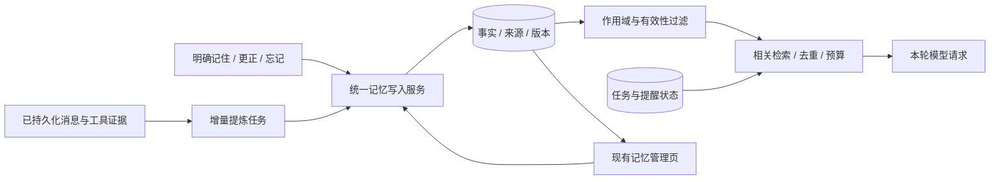

# miniQ 个人助手记忆内核方案

日期：2026-10-29。状态：首版内核已实施，范围和验证见[实施记录](2026-10-29-memory-kernel-implementation.md)。方向：个人助手，跨聊天记住偏好、项目背景和正在推进的事情。

用户已明确：现有记忆设置页够用，重点改内核。保留“当前项目 / 全局、搜索、分页、删除”的现有界面；不以视觉重设计作为记忆功能的依赖。本方案取代此前以交互草图为重点的方案。以下是分批路线图；实际实现的边界以实施记录为准。

依据：[13 个参考仓库调研](../compare/2026-10-29-reference-memory.md)及当前本地源码。落地前应在实际开发基线上重新核对接口和远端新增提交。

## 1. 目标与当前缺口

目标：用户无需反复交代背景；新信息能纠正旧事实；项目之间不串用；删掉的记忆不会被后台重新写回来；整个过程不拖慢正常聊天。

当前 miniQ 已有 global/workspace 记忆表、memory_write/search 工具，以及管理列表和并发删除保护。主要缺口如下：

| 当前行为 | 内核需要提供的行为 |
| --- | --- |
| 主要由模型显式调用工具保存 | 明确写入与受控增量提炼共用一个写入入口 |
| create_memory 每次 INSERT | 新增、更新、无变化、冲突待确认的明确结果 |
| LIKE 子串匹配，按更新时间排序 | 当前作用域内的相关性检索，支持中文和同义表达 |
| 未见通用每轮自动预取 | 每个用户轮次开始时自动提供少量有效记忆 |
| 条目缺少来源、版本和替代关系 | 每条事实有可验证来源；旧版本停止作为当前事实使用 |
| 删除当前行 | 同时处理版本、索引、缓存、派生来源及后台任务竞态 |
| 当前会话压缩与任务记忆各自存在 | 保持职责清楚，增加有来源的跨聊天延续信息 |

## 2. 核心结构

保留 Rust + SQLite，不引入独立记忆服务器。事实、来源和任务状态是权威数据；全文或向量索引均可重建。Markdown 可以导出，但不再作为第二份可独立写入的事实源。

职责划分：

- `miniq-memory`：持久化、事务、版本与来源、遗忘、检索索引。数据库锁内不进行模型或网络调用。
- `miniq-daemon` 的独立 memory 模块：提炼模型调用、后台任务调度、读写政策及本轮记忆选择。`turn.rs` 只接入入口，不继续堆积业务逻辑。
- `miniq-tools` 与 gateway：通过统一记忆服务读写，不各自实现去重或过滤。scope 从可信会话和用户操作推导，不能由模型任意扩大。
- `miniq-agent`：继续负责模型循环与上下文预算；记忆以背景数据进入请求，不成为新的系统权限或工具授权。
- `miniq-protocol`：定义共享枚举、参数、返回值与 JSON Schema，同步前端类型及运行时校验。

## 3. 写入：记住事实，不复制整段对话

### 3.1 两条入口，一套规则

明确的“记住 / 改成 / 忘记”走同步路径，数据库提交成功后才确认完成。自动提炼在轮次内容已经持久化后异步执行，合并短时间内的多次变化，不阻塞回复。

提炼只消费新增来源，通过持久化游标推进。复用现有 messages、工具历史、附件与执行结果，不另外保存一份全量原始聊天。长来源按页或批次处理，并保留完整证据读取能力；不固定截取最近若干条作为永久策略。

提炼结果是候选，不是权威。统一服务检查来源、归属、确认方式、有效时间、当前版本及遗忘规则后再提交。

### 3.2 应保存的内容

- 用户明确表达的稳定偏好，保留适用条件，例如“工作报告先给结论”。
- 用户确认的项目目标、约束、预算、决策和事实。
- 有来源的项目经验；工具事实需验证执行结果，不能只采用助手的成功宣称。

一次性要求、假设、引用他人的话、角色扮演、AI 猜测和工具返回的指令不自动成为用户事实。凭证继续交给凭证机制；敏感个人信息只在用户明确要求时处理，不从旁证自动推断。

来源可信度与未来价值分开判断。“来自用户”不代表永久有效，“被模型引用很多次”也不代表事实更可靠。

### 3.3 更新与去重

统一返回 `added / updated / unchanged / needs_confirmation`。

完全重复的有效事实返回 unchanged。检索出的相似条目只是候选；自动更新必须有相同对象、属性、条件和作用域的依据，或用户明确指向旧事实进行更正。不能把 Jaccard 或 embedding 相似度超过阈值当成事实冲突证明。

用户明确更正优先于旧来源和自动提炼；当前明确要求优先于保存的偏好。“这次用英文”只影响当前任务，“以后默认英文”才改变长期偏好。

旧版本保留可追溯关系，但退出普通召回。只有用户明确问历史变化时，才能作为历史事实读取。更新事务使用 expected revision，迟到的提炼任务不能覆盖用户刚改的内容。

## 4. 读取：让下一次聊天真正受益

每个用户轮次开始时执行一次本地召回，供该轮模型循环使用；不在每次工具调用前重复整套检索。模型需要更多来源时继续用分页读取工具。

召回次序：

1. 解析当前个人空间、workspace、会话设置和用户本次约束。
2. 过滤无权限、非最新、遗忘、来源撤销、不在适用期内的记录。
3. 提供少量稳定通用偏好，再检索与本轮有关的项目事实。
4. 去重、处理未决冲突，按相关性与上下文预算选择内容。
5. 记录本轮实际提供给模型的 ID/revision，供诊断及后续评估。

第一版先建设 SQLite FTS5/BM25；必须单独验证中文、短词、人名、日期、金额、中英文混合表达。可比较分词后索引与 trigram 的效果，不直接假定默认英文 tokenizer 够用。

“继续上次”“按照我的习惯”要结合当前项目和最近话题构造检索输入，不能只搜索这几个字。存在多个合理目标时询问一次，不猜项目。无相关事实时允许返回空。

初始预算建议：合计约 1500 tokens 上限，稳定偏好约 300，其余用于相关事实和延续索引。预算是上限，不是必须填满。长内容通过来源读取补足，不截断原始数据。使用模型 tokenizer 或保守估算。

只有在固定评估集暴露明显的同义表达漏召回后，再加本地或用户配置的 embedding，并通过 RRF 与关键词检索融合。向量索引记录模型版本、维度、来源版本；模型变化后重建，不混用不同向量空间。第一版不需要外部向量数据库或知识图谱。

稳定内容与动态内容分开组织以便缓存；两者均作为背景数据，不冒充系统指令。注入的记忆不再次作为新证据提炼，防止自我强化。

## 5. 遗忘、失效与竞态

沿用现有页面的删除行为，第一版不新增“最近忘记”或恢复期来改变用户理解。需要恢复时作为后续独立能力设计并明示保留政策。

删除或“忘记”应在统一服务里完成：撤销目标事实及旧版本的可用状态，移除派生索引，失效缓存，记录不含明文内容的必要来源撤销信息，并使旧后台任务无法重新提交。

关键约束：

- 检索索引重建只读取仍然有效的记录，不能从历史版本恢复已忘记内容。
- 提炼提交时重新检查 source revision、目标 revision、设置与处理代次；不能仅在任务开始时检查。
- 遗忘的来源及已知派生链从自动提炼中排除，重复处理不改变结果。清空全部记忆设置新的处理边界，不自动回扫旧聊天。
- 对同义重述和多来源事实建立专门回归场景；不能宣称一次删表就解决所有语义遗忘。
- 用户主动重新要求记住时，才能明确解除对应排除状态。
- 已发送给模型的内容无法撤回；下一次请求必须重建有效上下文。旧会话压缩摘要中的失效记忆也必须通过引用标记剔除，不能持久化成无来源的新事实。

删除记忆不删除原聊天。用户主动打开原聊天仍可看到原文，但不因此自动重新保存。删除来源消息时，检查依赖它的事实：没有独立有效依据的条目停止自动使用；不能继续把不存在的来源当作证据。

## 6. 跨聊天连续性与待办

“关于用户的长期事实”与“当前事情的状态”分开存储。为会话/项目生成可增量刷新的延续记录：目标、已确认决定、已完成事项、未解决问题、资料引用、观察时间及来源位置。

新聊天要求继续时，读取延续记录并核验关联任务的最新状态。摘要说“待处理”，但任务已经完成时，以任务系统为准。现有执行任务、会话目标和定时任务不自动等价于个人待办；第一版复用其真实能力，不能用一个记忆字符串伪造待办状态机。

“明早提醒我”必须创建真正的定时任务才能承诺提醒；记忆只提供任务背景。“下周准备做”不能自行转成提醒。任务完成/取消后，对应延续记录及时失效或刷新。

定时任务的 task memory 保持原有独立作用域，不混入全局偏好。后台工具执行失败或轮次取消不能产生“已完成”的长期事实。

## 7. 数据结构与后台可靠性

最小数据概念如下；按职责组织，不为每个名词机械增加一层：

- 事实：逻辑 ID、scope/workspace、类型、主体/属性（可选结构化槽）、完整内容、条件、有效期、revision、状态、确认方式及时间。
- 来源：会话/消息/工具结果 ID、来源类型、版本/哈希与定位范围；一项事实只关联真正支持它的证据。
- 版本：旧内容、替代关系和变更原因；同一逻辑事实最多一个当前版本。
- 后台任务：来源区间、游标、提炼器版本、租约、重试与处理代次。
- 参考记录：本轮实际注入的 ID/revision，不宣称能证明模型每句话都使用了它。
- 遗忘排除：作用域、逻辑 ID、来源及必要去重标识；不以保留明文旧事实作为永久删除后的“审计”。

后台模型调用在事务外执行。结果与游标原子提交；失败不推进游标，重试不重复写入。限制并发、每批输入、超时和费用，保留待处理工作，不能因预算不足丢掉来源。

提炼使用用户已配置的模型路线；不静默把对话发到另一家 provider。模型不可用时，明确保存、更正、删除和现有记忆检索仍能工作。

协议由 Rust serde/schemars 共享定义，工具 JSON Schema、返回值、前端类型及运行时校验同步。现有 memory_search 的 limit schema 与运行时 clamp 应在替换接口时一并统一。

个人数据首先以当前 daemon 的存储边界为准。桌面和连接同一 daemon 的手机共享同一版本；不同电脑上的独立 daemon 不因该方案自动获得跨设备同步。

## 8. 代码落点与迁移

| 现有位置 | 内核修改 |
| --- | --- |
| [miniq-memory/store/memories.rs](../../crates/miniq-memory/src/store/memories.rs) | 来源/版本/事务、更新和遗忘、有效记录查询、全文索引 |
| [miniq-protocol/memory.rs](../../crates/miniq-protocol/src/memory.rs) | 强类型读写和来源协议、revision 校验 |
| [miniq-tools/memory.rs](../../crates/miniq-tools/src/memory.rs) | 共用内核服务，保存结果语义、更新/遗忘入口、schema 一致性 |
| [miniq-daemon/turn.rs](../../crates/miniq-daemon/src/turn.rs) | 请求前召回、持久化后调度；新逻辑拆入职责明确的 memory 模块 |
| [miniq-agent/context.rs](../../crates/miniq-agent/src/context.rs) | 记忆动态引用和压缩/恢复边界，防止旧内容再次固化 |
| [gateway/memory.rs](../../crates/miniq-daemon/src/gateway/memory.rs) | 现有管理接口调用统一内核，维持分页和并发保护 |

保留当前管理页结构与样式。若协议需要新增字段，仅作必要的数据适配；来源展示或开关属于后续独立小改动，不扩大本轮范围。现有全局/项目分区和删除保护必须保留。

历史条目保留原文和作用域；无法回溯来源时标记来源未知，不伪造用户确认。迁移后所有调用方使用新逻辑，删除被替代的旧分支和旧 helper，不同时维护两套记忆读写。

自动提炼和自动写入仍受用户设置与既有审批系统控制。当前 memory_write 的 Medium 风险不能被后台路径绕过；智能记忆授权只覆盖清楚限定的记忆动作，不扩大其他工具权限。关闭自动保存与停止使用已有记忆是不同政策，临时会话两者都关闭。

## 9. 实施顺序

**第一批：把已有记忆用好。** 建立来源、版本、更新和遗忘事务；接入每轮召回；中文关键词检索；统一工具与管理接口。先验证一条真实偏好能跨会话使用、更正和删除。

**第二批：让它主动学会。** 接入持久化的增量提炼任务、来源游标、租约和有限自动写入政策；增加项目延续记录及任务状态关联。避免在可靠更新和遗忘之前大量自动写入。

**第三批：针对漏召回增强。** 用同样来源、模型、预算和查询对比 BM25 与混合检索；确有收益再增加 embedding、RRF 或重排。图谱、外部多后端和跨产品导入不作为第一版依赖。

## 10. 验收标准

必须覆盖新聊天、重启、并发、失败恢复和多项目场景：

1. 稳定偏好跨聊天生效；本次例外不会修改长期偏好。
2. 同一事实的更正使旧版本退出普通召回；迟到提炼不覆盖新值。
3. 删除后缓存、索引重建、来源重放和压缩摘要都不能使其恢复。
4. 同名项目实体、不同预算和不同作用域不串用。
5. 临时会话不读写长期记忆；中途关闭自动保存后待处理任务遵循新政策。
6. 角色扮演、引用和模型猜测不成为确认事实。
7. 失败/取消轮次不产生虚假完成事实；任务完成后不再显示旧待办。
8. 大型来源可完整分批读取，重试不丢失或重复事实。
9. 没有相关事实时不强行注入；多来源问题评估是否找到全部必要证据。

同时测错误注入率、遗漏率、用户更正生效率、遗忘成功率、后台 token/费用和前台增量时延。作用域泄漏、旧版覆盖和删除复活的回归用例必须零失败。

建议在固定机器、1 万条记忆上先测本地召回 p95 <100ms 的目标，自动提炼不阻塞前台；这只是设计目标，尚未取得实测结果。最终质量用固定中文和中英混合跨会话场景评估，不把“命中一个来源”当成最终回答准确率。

## 11. 参考项目的具体取舍

采用 MicroClaw 的稳定/相关分层、LibreFang 的写入决策、Codex 的来源与后台任务、AgentMemory 的旧版本退出召回、IronClaw 的作用域和并发保护，以及 Moltis 的删除与派生索引一致性。

miniQ 已经持久化聊天，无需复制 AgentMemory 的外部 hooks/iii-engine。重要的是在当前内核贯通“来源 → 事实 → 更新 → 召回 → 遗忘”，并验证下一次聊天的行为确实改变。
